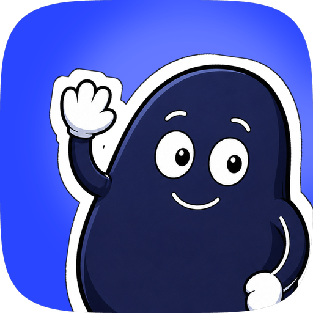
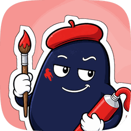

<p align="center"></p>

# skills

My personal Claude Code skills: workflows distilled from real projects, written for the agent rather than for me. Each skill is one folder with a `SKILL.md` and the reference files it points at.

Global skills are symlinked into every Claude profile (`~/.claude` and each `~/.claude-*` dir that T3 Code launches through `CLAUDE_CONFIG_DIR`) so Claude Code picks them up in every project. A skill with `project: <name>` in its frontmatter is symlinked into that repository's `.claude/skills/` instead, so it only triggers there; `projects.txt` maps the name to the checkout.

The rest of the shared setup lives in `profile/` and is synced the same way: plugins and their marketplaces, user MCP servers, hooks and permissions, and files like rules. Change it here, not in a profile, or the next sync puts it back. Written with Claude in [T3 Code](https://t3.gg).

## Skills

| Skill | Use it for |
|:-:|---|
| [](report-deck/SKILL.md)<br>[report&#8209;deck](report-deck/SKILL.md) | A paged data report as a PDF to send and an offline HTML deck to present, from one set of fixed-size pages: JSON from a slow pass, headless Chrome, an overflow gate. |
| [](report-web/SKILL.md)<br>[report&#8209;web](report-web/SKILL.md) | A scrolling data report as one offline HTML file for laptop, tablet or phone: one section per claim, a contents rail, hover values, a headless Chrome check. |
| [](learn/SKILL.md)<br>[learn](learn/SKILL.md) | Answer a learning question from verified sources and file it as a note. Scoped to the [study](https://github.com/ubeann/study) repo. |
| [](video-context/SKILL.md)<br>[video&#8209;context](video-context/SKILL.md) | Turn a video URL or file into a bundle an agent can read: post text, captions or whisper transcript, deduplicated frames, and a timestamped summary. |
| [](ux-behaviour-audit/SKILL.md)<br>[ux&#8209;behaviour&#8209;audit](ux-behaviour-audit/SKILL.md) | Audit a UI by how users behave on it: walk one task, six behaviour lenses, a junior-to-staff ladder, persuasion flags, case studies with video timestamps, a report rendered in chat. |
| [](design-direction/SKILL.md)<br>[design&#8209;direction](design-direction/SKILL.md) | Direction before UI is generated: a brief with the bet against the category's assumption, one job per reference, a DESIGN.md token system for app, website or desktop, and a drift count of type, spacing, colour and radius on the built screens. |
| [](moodboard/SKILL.md)<br>[moodboard](moodboard/SKILL.md) | A local library of design references from X, Threads, Instagram, YouTube or any site: each broken into its technique, a trend count across authors, and project boards where every reference has one job. |
| [](brand-art/SKILL.md)<br>[brand&#8209;art](brand-art/SKILL.md) | Mascots, illustration sets, scene art and app icons that keep one identity: an art bible, the owner's seed, an identity pack with a hero and turnaround, one change per call through Recraft or Higgsfield, file cleanup, and a drift score against the hero. |
| [](motion-direction/SKILL.md)<br>[motion&#8209;direction](motion-direction/SKILL.md) | How a product moves, decided before it is built: a motion brief with one focal moment, duration and easing tokens, one runtime per job (CSS, Motion, GSAP, Rive, Lottie, HyperFrames) inside a budget, a beat sheet per sequence, and frame-by-frame review with a motion drift count. |

## Layout

```
<name>/SKILL.md           the skill: frontmatter, steps with completion criteria
<name>/references/        files the skill points at, loaded only when needed
scripts/check_skills.py   validates frontmatter and reference links
scripts/sync_profiles.py  syncs skills and profile/ into every Claude profile
scripts/link.sh           the skills step only
projects.txt              project name -> checkout path for project-scoped skills
profile/settings.json     keys merged into each profile's settings.json: plugins, marketplaces, hooks, permissions
profile/mcp.json          user-scope MCP servers; write secrets as ${VAR}, read from the env at sync time
profile/skill-sources.txt skills kept outside this repo (npx skills, but, yab), linked into each profile from where they live
profile/home/             files symlinked into each profile at the same path (rules/, CLAUDE.md, agents/)
assets/                   the toolbox mascot, one character per skill in skills/
art/mascots/              how the characters are made: shared rules, prompts, cutouts, export.py
AGENTS.md                 pointers for any coding agent working here
```

## Workflow

1. Finish a piece of work somewhere, run a retro, and keep what was portable.
2. Open the **skills** project in T3 Code and ask for a skill from the retro. The `writing-for-agents` skill sets the house style: steps end on a checkable criterion, reference lives behind pointers.
3. Run the checker, commit, merge, then run `scripts/sync_profiles.py` (it always links from the main checkout, so a worktree being deleted never leaves dangling links).

## Commands

```sh
python3 scripts/check_skills.py   # validate every skill
python3 scripts/sync_profiles.py  # sync every profile: plugins, mcp, settings, skills, files
python3 scripts/sync_profiles.py --dry-run --only settings   # preview one step
python3 scripts/sync_profiles.py --drift    # what a profile has that the repo does not
sh scripts/link.sh                # skills only
```

## Profile sync

Every change goes through `profile/` (or a skill folder) in a PR. Once it merges, each profile picks it up on its next session start: the shared `SessionStart` hook runs `sync-claude-profiles --current --pull`, which fast-forwards the main checkout (only when it is clean and on `main`) and syncs the profile that is starting. Run `python3 scripts/sync_profiles.py --pull` to update every profile at once.

| To | Change | The next sync, in every profile |
|---|---|---|
| Add a plugin | `enabledPlugins` (and its marketplace in `extraKnownMarketplaces`) in `profile/settings.json` | adds the marketplace, installs the plugin |
| Turn a plugin off | set it to `false` | keeps it installed, disabled |
| Remove a plugin | delete its `enabledPlugins` entry; delete the marketplace too if nothing else uses it | uninstalls it; removes the marketplace unless a plugin still installed in that profile needs it |
| Add, change or remove an MCP server | `profile/mcp.json` | `claude mcp add-json` / `remove` at user scope |
| Add or remove a repo skill | the skill folder | links it / removes the link |
| Add or remove a skill another tool installs | a line in `profile/skill-sources.txt`, or `!name` to skip one | links it / removes the link; the installer's copy itself is never deleted |
| Change any other setting (hooks, permissions, `env`) | `profile/settings.json` | merges it; a key or list entry deleted here is deleted there |
| Add or remove a rule, `CLAUDE.md`, agent | a file under `profile/home/` | links it / removes the link |

- Profiles are `~/.claude` plus every `~/.claude-*` dir; set `CLAUDE_PROFILES=dir:dir` to choose others.
- Only what the sync added is ever removed: it records that in `<profile>/.skills-sync.json`. Anything a profile has on its own (its `theme`, a plugin tried with `/plugin`) stays. `--drift` lists those, so you can promote one into `profile/` or remove it.
- Settings are merged, not replaced: shared keys win, list entries (hooks, permission rules) are added to the profile's own.
- Skills installed by other tools stay where their installer keeps them, so an update lands everywhere. A copy identical to the source is replaced by a link; a copy that differs is left alone with a warning.
- MCP servers and plugins go through the `claude` CLI, never by editing `.claude.json`, which also holds the profile's login. OAuth MCP servers still need signing in once per profile.
- A new profile gets everything on its first session; run the sync by hand for it once if you want it ready sooner, since adding marketplaces clones them.
- This repo is public: keep tokens out of `profile/`; write them as `${VAR}` in `profile/mcp.json`.
